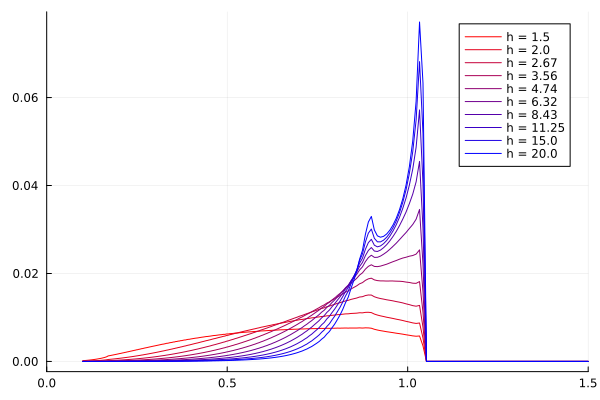

## Current project

I model how the shape of the corona
changes the illumination of the disc

::: {.callout-note}
## Paper in preparation
Papers will be listed on
[NASA ADS](https://ui.adsabs.harvard.edu/).
:::

{width=80%}